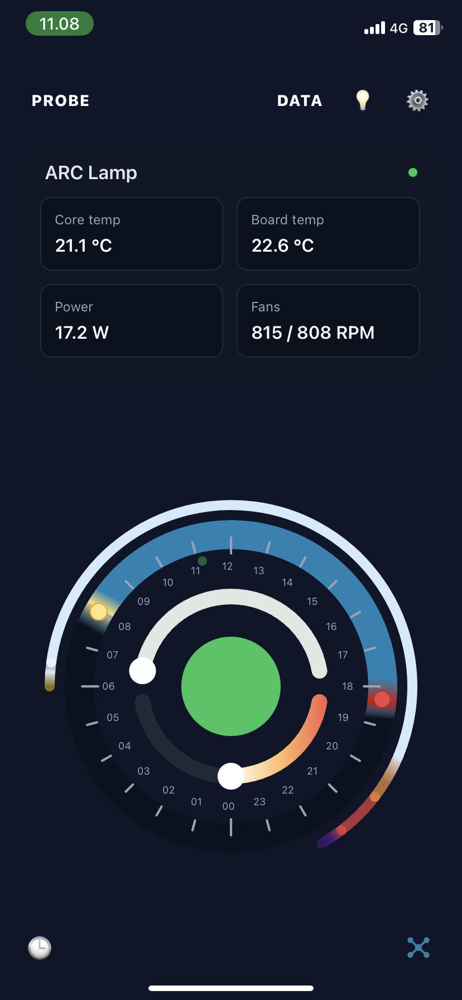
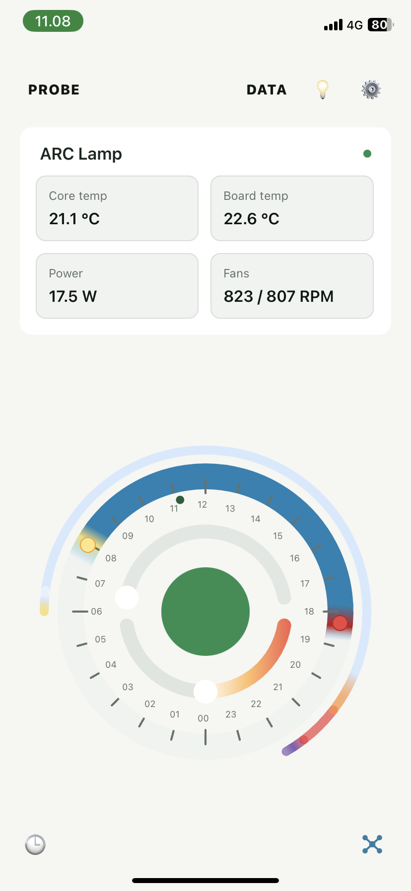

# ARC React Native App

*Intelligent interaction with the physical world.*

ARC App brings intelligent lighting, environmental sensing, and connected physical systems into a unified mobile experience. Developed alongside ARC hardware and firmware, it lets people configure lighting behavior, explore measurements, and examine historical telemetry.

This repository contains the actual React Native implementation: shared TypeScript, native iOS and Android projects, protocol clients, and tests. Through ARC Open Development, we invite technical exploration and collaboration.

### ARC app · Dark and light

<p align="center">
  
  &nbsp;
  
</p>

## What is implemented

- Lighting channels, power and fan controls, device limits, schedules, and photoperiod visualization.
- Device selection, account sign-in, Claim Device integration, and permission-aware cloud views.
- Environmental telemetry, historical graphs, BLE history transfer, local history storage, and cloud synchronization.
- Lamp telemetry interval controls with device confirmation, theme selection, and multilingual catalogs.
- Native BLE interfaces and retained legacy Bluetooth Mesh integration.

These are source capabilities. Availability depends on the device firmware, local connection, account permissions, and platform. Persistent authenticated Probe assignment and independent offline authorization are not complete.

## Platform status

**iOS:** ARC's primary hardware-tested development platform. We have a TestFlight experience for interested collaborators and investors. This candidate passed an unsigned native iOS device build; signing, fresh on-device validation, and release decisions remain separate. See [validation](docs/validation.md).

**Android:** The ARC React Native application has been successfully built and launched on Android 14, with native Kotlin BLE integration and hardware communication tested on a Samsung Galaxy Tab A8. The shared application now runs on both iOS and Android, including device discovery, live Lamp telemetry, lighting controls, and the graphical interface. Automated regression tests pass (111/111). Further validation and refinement remain necessary before production release. See the [visual asset plan](assets/README.md).

## Architecture

`App.tsx` composes the experience. `src/ui`, `src/graph`, and `src/i18n` provide presentation; `src/cloud` implements account and Portal clients; `src/mesh`, `src/ble`, and `src/protocol` provide device-facing interfaces. `src/security` contains permission checks and foundations for a future hardware trust layer.

Current ARC hardware uses STM32WBA5 BLE and OpenThread alongside the STM32G4 Lamp controller. The phone uses BLE and cloud APIs; it does not operate the Probe's Thread radio. STM32WBA5 firmware remains private. The client-facing packet formats are inspectable in this app.

Read [architecture and limitations](docs/architecture.md) and [security boundaries](SECURITY.md).

## Development setup

The lockfile pins Expo 57.0.22, React Native 0.86.3, React 19.2.3, and TypeScript 6.0.3. Use `npm ci` to install the recorded dependency tree. This audit used Node 26.8.2 and npm 11.19.1; native compatibility must be checked with your toolchain.

```sh
npm ci
npx tsc --noEmit
node --test tests/*.test.cjs
```

Native mesh SDKs are **external prerequisites**, not silently disabled features. Obtain them under their own terms and install the audited files using [the SDK instructions](docs/native-sdks.md). Their omission from Git does not remove the native bridge implementation.

For iOS, use macOS, Xcode, CocoaPods, the external ST SDK, and your own signing configuration. If npm skipped Skia’s install script, run `npx --no-install install-skia` before CocoaPods:

```sh
pod install --project-directory=ios
open ios/LampBLE.xcworkspace
npm start
```

Select your signing team in Xcode and run the `LampBLE` scheme on a suitable device. The published project does not include ARC signing credentials or a development team. The existing `npm run ios` script invokes Expo's native build command.

For Android, review the recorded Gradle/autolinking blockers before attempting `npm run android`. Install a supported JDK and Android SDK and obtain the external AAR. Generate your own local debug keystore if retaining the existing debug-signing configuration; **the current release build also uses that debug signing configuration and is not a production release setup**. Do not run native-project regeneration as a shortcut: it can overwrite custom modules.

`.env.example` documents client configuration. Firebase identifiers and API endpoints are public client configuration, not administrative credentials. Accounts, device access, and backend authorization are still required. `src/cloud/arcCloud.ts` retains the original configuration fallbacks; supplying an empty environment variable does not necessarily disable them. Never add service-account keys or signing secrets.

## Verification and maturity

[Validation results](docs/validation.md) distinguish automated checks from native build and hardware testing. Tests cover history framing/cursors, cadence, permissions, cloud history, translation catalogs, and diagnostics. They do not prove device authentication or a functioning Android deployment.

The repository is a publication candidate, with legacy native dependencies and commissioning boundaries still under review. The next release decision follows that review and the preliminary Android launch assessment. Existing English and Danish cadence definitions are preserved; the other catalogs explicitly use canonical English fallback strings for those controls.

## Explore and collaborate

- [ARC Open Development](https://github.com/arc-motion-light/arc-open-development)
- [ARC STM32G4 Lamp firmware](https://github.com/arc-motion-light/arc-stm32g4-lamp-firmware)
- [ARC website](https://arcstore.io)

For collaboration, TestFlight enquiries, or commercial licensing, contact [juan@arcstore.io](mailto:juan@arcstore.io). The separate multilingual UX/UI presentation is being prepared locally and is not linked as a public repository.

## Rights

ARC-owned original code is offered under [PolyForm Noncommercial 1.0.0](LICENSE), a source-available license, not an OSI-approved open-source license. ARC-owned documentation uses [CC BY-NC 4.0](licenses/CC-BY-NC-4.0.txt). Third-party components retain their own licenses; logos and reserved visual assets are separately scoped in [LICENSING.md](LICENSING.md), [THIRD_PARTY_NOTICES.md](THIRD_PARTY_NOTICES.md), and [TRADEMARKS.md](TRADEMARKS.md).
